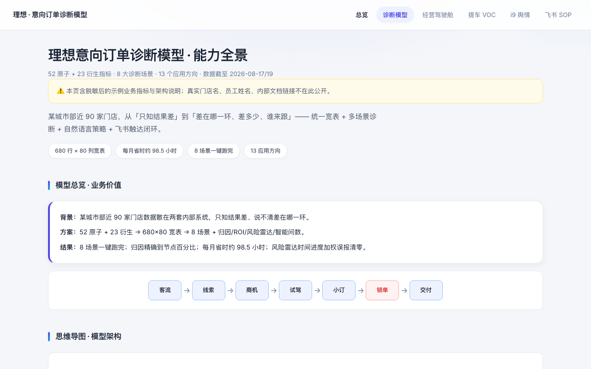
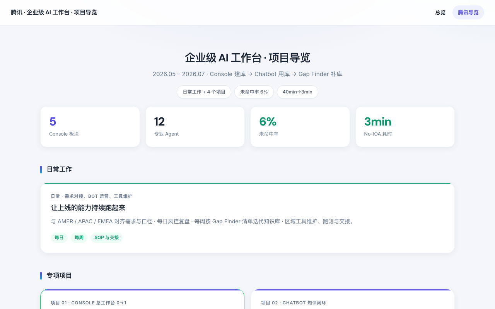

# 你好，我是张文婧（Anna）👋

**AI 产品 / 数据产品 · 把复杂业务拆成可度量的指标、可解释的规则，和一线真正会用的工具**

*AI & Data Product · CUHK-Shenzhen MSc Financial Mathematics · Li Auto / Tencent / ByteDance / TCL*

## 🙋‍♀️ 关于我

- 🎓 香港中文大学（深圳）金融数学硕士 · 苏州大学统计学本科
- 💼 四段实习：**理想汽车** 销售策略 · **腾讯** 企业级 AI 工作台 · **字节跳动** Seed AI 数据产品 · **TCL** 企业系统产品
- 🏆 FlagOS 全球 AI 挑战赛 **全球 Top 2**（队长）
- 🛠 擅长 0→1 产品搭建、数据看板与诊断引擎、Agent 编排与跨团队推进；可用英文工作沟通

## ✨ 精选项目

<table>
<tr>
<td width="50%" valign="top">

**[Retail KPI Cockpit](https://github.com/annawzhang/retail-kpi-cockpit)** · 零售门店经营诊断驾驶舱

把门店日报变成「今天先管谁、为什么、找谁管」：配置化指标口径、同层健康分、预警归因与责任分派、自动文字结论。零依赖 Python，演示数据。

[在线演示](https://annawzhang.github.io/retail-kpi-cockpit/) · [代码](https://github.com/annawzhang/retail-kpi-cockpit)
</td>
<td width="50%" valign="top">

**[面试作品集](https://github.com/annawzhang/portfolio)** · 四段实习项目导览

每个项目按「背景 → 方案 → 架构 → 结果」拆成独立页面，含经营驾驶舱、诊断模型、舆情洞察、多 Agent 知识闭环等。数据已脱敏。

[在线浏览](https://annawzhang.github.io/portfolio/) · [代码](https://github.com/annawzhang/portfolio)
</td>
</tr>
<tr>
<td width="50%" valign="top">

**[意向订单诊断模型](https://annawzhang.github.io/portfolio/lixiang-diagnosis-star.html)** · 理想汽车

近 90 家门店数据统一成 680 × 80 宽表，8 个诊断场景一键跑完，归因精确到漏斗节点，每月省时约 98.5 小时。
</td>
<td width="50%" valign="top">

**[企业级 AI 工作台](https://annawzhang.github.io/portfolio/tencent-ssc-overview.html)** · 腾讯

统一工作台 0→1；建库 → 用库 → 补库的多 Agent 知识闭环，知识库未命中率降至 6%，区域工具耗时 40 min → 3 min。
</td>
</tr>
</table>

**更多项目**：[HR Policy Monitor](https://github.com/annawzhang/hr-policy-monitor) —— 海外薪酬福利政策监控：多国官方 RSS 定时同步、关键词相关度打分、早报 / 周报推送与聊天机器人查询（Python · FastAPI · GitHub Actions）

## 💼 实习经历

| 时间 | 公司 · 方向 | 代表成果 |
|---|---|---|
| 2026.07 – 至今 | [**理想汽车**](https://annawzhang.github.io/portfolio/lixiang-overview.html) · 销售策略 | 门店级经营驾驶舱、覆盖 18 类流程的销售 AI 助手、7,000+ 条舆情洞察、50 家门店竞品商圈匹配 |
| 2026.05 – 2026.07 | [**腾讯**](https://annawzhang.github.io/portfolio/tencent-ssc-overview.html) · 企业级 AI 工作台 | 统一工作台 0→1、12 个专业 Agent 知识闭环、未命中率 6% |
| 2026.02 – 2026.05 | [**字节跳动**](https://annawzhang.github.io/portfolio/byte-seed-overview.html) · Seed AI 数据产品 | Agent 数据采集全链路、八维可解释评估模型（20,121 条样本）、漏斗 AB 实验，业务效率 +40% |
| 2025.12 – 2026.02 | [**TCL**](https://annawzhang.github.io/portfolio/tcl-hris-overview.html) · 企业系统产品 | 20+ 业务系统交互原型、OA 接口联调、SQL 调优 |

## 🏆 比赛与开源

**FlagOS 全球 AI 挑战赛 · OpenSeek 长上下文 ICL 标注赛道 · 全球 Top 2** —— TrialBlazers 队长

- 负责整体方案与全流程实现，主攻 Task 8
- 排行榜 **84.77** 分；Task 8 从 142/166 提升到 **166/166**；规则类任务提升 **82%+**
- 30K 长上下文 ICL、MMR 去冗余检索、标签均衡采样、生成 → 校验 → 修复（Pass@k）多轮流程
- [查看比赛提交（OpenSeek PR #223）→](https://github.com/FlagAI-Open/OpenSeek/pull/223)

其他奖项：中国国际大学生创新大赛 江苏省金奖 / 国家级铜奖 · 全国商业精英挑战赛 全国三等奖

## 🧰 技能

产品方法：PRD · 指标体系 · AB 实验设计 · 用户声音（VOC）分析 · Agent 编排

## 📫 联系

- Email：225010030@link.cuhk.edu.cn
- 作品集：<https://annawzhang.github.io/portfolio/>
