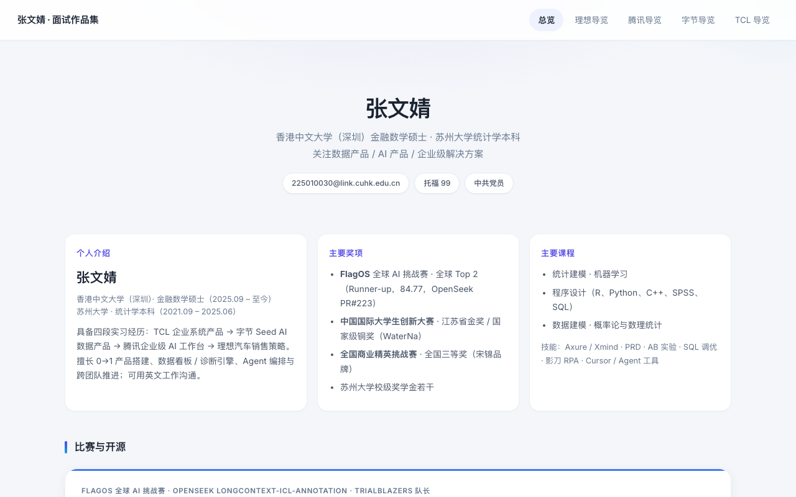

> **Copyright © 2026 张文婧 (Anna Zhang)** · [MIT License](./LICENSE) · [github.com/annawzhang](https://github.com/annawzhang)  
> 欢迎学习与面试查阅；保留版权与许可声明。**禁止删除作者信息后冒充本人作品二次发表。** 公开内容为虚构/脱敏演示数据。

# 你好，我是张文婧（Anna）👋

*希望统计能够借助 AI 杠杆，有更大的收获。*

[github.com/annawzhang](https://github.com/annawzhang)

*AI & Data Product · 统计学本科 · 金融数学硕士 · 理想汽车 / 腾讯 / 字节跳动 / TCL*

## 🙋‍♀️ 关于我

| | |
|---|---|
| **硕士** | 香港中文大学（深圳）· **金融数学** MSc |
| **本科** | 苏州大学 · **统计学** |
| **实习** | **理想汽车** 销售策略 · **腾讯** 企业级 AI / 人力相关工作台 · **字节跳动** Seed **AI 数据产品** · **TCL** **HRIS / 企业系统** |
| **能做什么** | 工作台 0→1 · Agent / 知识闭环 · 可解释评分与 AB · 经营诊断与 VOC · 商赛方法工具化 |
| **竞赛** | FlagOS 全球 Top 2 · 中国国际大学生创新大赛 **省金 / 国铜** · 全国商业精英挑战赛 **全国三等奖** |

## 🗺 按方向浏览

| 方向 | 入口 | 相关 |
|---|---|---|
| **理想 · 销售/数据策略** | [Handbook · 理想](https://annawzhang.github.io/people-product-handbook/sections/co-lixiang.html) · [Retail KPI](https://annawzhang.github.io/retail-kpi-cockpit/) | [VOC Agent](https://annawzhang.github.io/voc-voice-agent/) · [Sales Ops](https://annawzhang.github.io/sales-ops-assistant/) |
| **腾讯 · SSC / 企业 AI** | [Handbook · 腾讯](https://annawzhang.github.io/people-product-handbook/sections/co-tencent.html) · [98008](https://annawzhang.github.io/people-product-handbook/sections/10-agent-capability.html) | [Console](https://annawzhang.github.io/enterprise-ai-console/) · [Gap](https://annawzhang.github.io/kb-gap-finder/) |
| **字节 · 招聘数据产品** | [Handbook · 字节](https://annawzhang.github.io/people-product-handbook/sections/co-byte.html) · [Talent Scoring](https://annawzhang.github.io/explainable-talent-scoring/) | [Stats Kit](https://annawzhang.github.io/people-stats-kit/) · [作品集 · 字节](https://annawzhang.github.io/portfolio/byte-seed-overview.html) |
| **TCL · HRIS** | [Handbook · TCL](https://annawzhang.github.io/people-product-handbook/sections/co-tcl.html) · [HRIS](https://annawzhang.github.io/hris-prototype/?demo) | [作品集 · TCL](https://annawzhang.github.io/portfolio/tcl-hris-overview.html) |
| **竞赛 / 方法附录** | [BizCase Lab](https://annawzhang.github.io/bizcase-strategy-lab/) · [附录](https://annawzhang.github.io/people-product-handbook/sections/co-appendix.html) | [Skills](https://github.com/annawzhang/pm-hr-skills) |

## ✨ 精选项目

<table>
<tr>
<td width="50%" valign="top">

**[面试作品集](https://github.com/annawzhang/portfolio)** · 四段实习叙事

理想销售策略 · 腾讯企业 AI 工作台 · 字节数据产品 · TCL HRIS。背景 → 方案 → 架构 → 结果，数据脱敏。

[在线浏览](https://annawzhang.github.io/portfolio/)
</td>
<td width="50%" valign="top">

**[People Product Handbook](https://github.com/annawzhang/people-product-handbook)** · 按四段实习归类

导航对齐简历：**理想**（VOC/触达/经营）· **字节**（人才量化/AB）· **腾讯**（SSC/98008）· **TCL**（HRIS）；商赛/Skills/学习复刻进附录。

[在线阅读](https://annawzhang.github.io/people-product-handbook/)
</td>
</tr>
<tr>
<td width="50%" valign="top">

**[Enterprise AI Console](https://github.com/annawzhang/enterprise-ai-console)** · 企业级 AI 工作台（腾讯向）

权限分级知识库、机器人看板、系统自检、工具嵌入——工作台 0→1 的公开复刻。

[在线演示](https://annawzhang.github.io/enterprise-ai-console/)
</td>
<td width="50%" valign="top">

**[Hiring Agent](https://github.com/annawzhang/hiring-agent)** · 招聘运营智能体

白名单调用评分卡引擎；违规推进会被规则拒绝。对应「Agent 只能调规则、不能黑盒瞎推」。

[在线演示](https://annawzhang.github.io/hiring-agent/) · [Copilot 看板](https://annawzhang.github.io/hiring-copilot/)
</td>
</tr>
<tr>
<td width="50%" valign="top">

**[Explainable Talent Scoring](https://github.com/annawzhang/explainable-talent-scoring)** · 数据产品 / 可解释模型（字节向）

八维加权、S+/S/A/B/C、NOT EXISTS 排他 AB、索引调优。

[在线报告](https://annawzhang.github.io/explainable-talent-scoring/)
</td>
<td width="50%" valign="top">

**[Retail KPI Cockpit](https://github.com/annawzhang/retail-kpi-cockpit)** · 销售策略 / 经营诊断（理想向）

同层健康分、预警归因、责任分派——「今天先管谁」。

[在线演示](https://annawzhang.github.io/retail-kpi-cockpit/) · [BizCase 商赛](https://annawzhang.github.io/bizcase-strategy-lab/)
</td>
</tr>
</table>

## 🧪 可运行的项目复刻

**再次强调：内部生产数据与私有仓不公开。** 下表均为脱敏复刻——逻辑可讲、数字可点，但**不是**公司真实库表或线上配置。

| 来源 / 方向 | 项目 | 一句话 |
|---|---|---|
| TCL · HRIS | [HRIS Prototype](https://github.com/annawzhang/hris-prototype) · [演示](https://annawzhang.github.io/hris-prototype/?demo) | 入转调离多级审批、编制、OA 映射与重试 |
| 腾讯 · 工作台 | [Enterprise AI Console](https://github.com/annawzhang/enterprise-ai-console) | 企业 AI 工作台：知识库权限、机器人、自检 |
| 腾讯 · 补库 | [KB Gap Finder](https://github.com/annawzhang/kb-gap-finder) | 知识缺口：信号 → 聚类 → 补库建议 |
| 腾讯 · 费用 | [Cost Allocation](https://github.com/annawzhang/cost-allocation-workbench) | 跨主体分摊校验 + 精确到分 |
| 字节 · 数据产品 | [Talent Scoring](https://github.com/annawzhang/explainable-talent-scoring) | 八维可解释评分 + 排他 AB |
| 学习 / Agent | [Hiring Agent](https://github.com/annawzhang/hiring-agent) · [Hiring Copilot](https://github.com/annawzhang/hiring-copilot) | 结构化招聘 Agent + 看板 |
| 理想 · 经营 | [Retail KPI](https://github.com/annawzhang/retail-kpi-cockpit) | 门店诊断驾驶舱 |
| 理想 · VOC Agent | [VOC Insight](https://github.com/annawzhang/voc-insight-kit) · [Voice Agent](https://github.com/annawzhang/voc-voice-agent) | 无引用不回答 · 禁止话术 · [独立架构页](https://annawzhang.github.io/people-product-handbook/sections/11-voc-agent.html) |
| 理想 · 流水线 | [Sales Ops Assistant](https://github.com/annawzhang/sales-ops-assistant) | 触达护栏：幂等、时间窗、授权、留痕 |
| 方法开源 | [Handbook](https://github.com/annawzhang/people-product-handbook) · [Stats Kit](https://github.com/annawzhang/people-stats-kit) · [Skills](https://github.com/annawzhang/pm-hr-skills) | 手册 / 统计工具箱 / SOP |
| 商赛方法 | [BizCase Strategy Lab](https://github.com/annawzhang/bizcase-strategy-lab) | TAM/竞品/UE/五力/监控（虚构案） |

### 零密钥开源 Skills（欢迎直接用）

| Skill | 层 | 做什么 | 链接 |
|---|---|---|---|
| **减幻觉 · 引用落地** | L3 | 无引用不下结论 | [citation-grounding](https://github.com/annawzhang/pm-hr-skills/tree/main/skills/citation-grounding) |
| **安全治理 · 内容护栏** | L4 | P0–P3 双侧检查 | [content-safety-rails](https://github.com/annawzhang/pm-hr-skills/tree/main/skills/content-safety-rails) |
| **工具白名单** | L1 | 越权工具调用拒绝 | [tool-whitelist](https://github.com/annawzhang/pm-hr-skills/tree/main/skills/tool-whitelist) |
| **发布脱敏检查** | L4 | 公开前扫手机号/密钥形态 | [publish-desensitize](https://github.com/annawzhang/pm-hr-skills/tree/main/skills/publish-desensitize) |
| **护栏评测** | L4 | 该拒就拒的最小用例集 | [agent-eval-rails](https://github.com/annawzhang/pm-hr-skills/tree/main/skills/agent-eval-rails) |

分层地图：[手册 §12](https://annawzhang.github.io/people-product-handbook/sections/12-layer-build.html) · 仓库 [pm-hr-skills](https://github.com/annawzhang/pm-hr-skills)
**私有仓（不对外开链）**：企业底稿与带抓取/部署密钥的数据包（`ssc-*` / `fpp-*` / payroll / policy-monitor 等）为 **Private**；面试只看公开 Demo 与上述 Skills。

## 💼 实习经历

| 时间 | 公司 · 方向 | 代表成果 |
|---|---|---|
| 2026.07 – 至今 | [**理想汽车**](https://annawzhang.github.io/portfolio/lixiang-overview.html) · **销售策略** | 门店经营驾驶舱、18 类流程销售 AI 助手、7,000+ 舆情洞察、50 家门店竞品商圈 |
| 2026.05 – 2026.07 | [**腾讯**](https://annawzhang.github.io/portfolio/tencent-ssc-overview.html) · **企业级 AI 工作台** | 统一工作台 0→1、12 个专业 Agent 知识闭环、未命中率 6% |
| 2026.02 – 2026.05 | [**字节跳动**](https://annawzhang.github.io/portfolio/byte-seed-overview.html) · **Seed AI 数据产品** | Agent 采集全链路、八维可解释评估（20,121 样本）、漏斗 AB，效率 +40% |
| 2025.12 – 2026.02 | [**TCL**](https://annawzhang.github.io/portfolio/tcl-hris-overview.html) · **企业系统 / HRIS** | 20+ 业务系统原型、OA 联调、SQL 调优 |

## 🏆 比赛

**FlagOS · OpenSeek · 全球 Top 2**（队长）— [PR #223](https://github.com/FlagAI-Open/OpenSeek/pull/223) · 榜 **84.77** · Task 8 **166/166**

**全国商业精英挑战赛 · 全国三等奖（宋锦）** — PEST + 波特五力 + LDA/SEM；公开方法见 [BizCase Lab](https://annawzhang.github.io/bizcase-strategy-lab/)

**中国国际大学生创新大赛 · WaterNa · 省金 / 国铜** — 硅基光伏耦合；数据 pipeline 支撑商业化测算

## 🧰 技能

产品方法：PRD · 指标体系 · AB 实验 · VOC · Agent 编排 · 工作台 0→1 · 经营诊断 · 商赛测算

## 📫 联系

- Email：225010030@link.cuhk.edu.cn  
- 作品集：<https://annawzhang.github.io/portfolio/>  
- 手册：<https://annawzhang.github.io/people-product-handbook/>
